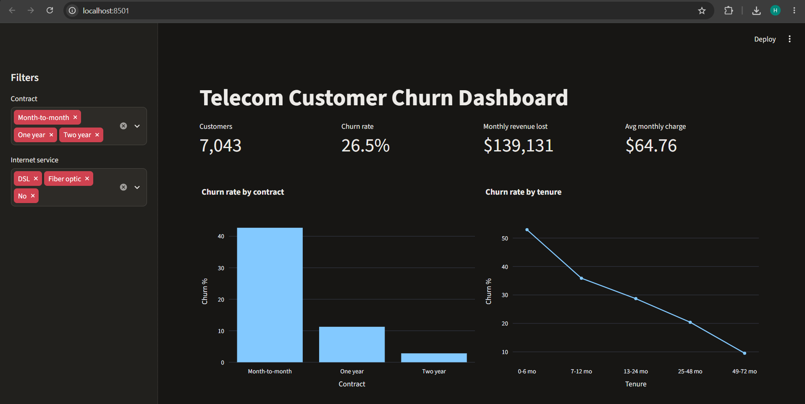

# Telecom Customer Churn Analysis & Dashboard

Analysis of 7,043 telecom customers to find why customers leave, how much revenue it costs, and who to target for retention.

## Key findings
- **26.5% churn rate**, costing **$139K/month** (30.5% of monthly revenue).
- **Month-to-month contracts churn at 42.7%**, compared with 11.3% for one-year and 2.8% for two-year contracts.
- The highest-loss segment is **month-to-month fiber customers in their first 6 months**: 74.2% churn and $37K/month lost.
- **First-year month-to-month customers** (1,994 people) churn at 51.4%. Retaining 20% of them would save about **$164K/year**.

## Churn prediction model
Random Forest classifier: **ROC-AUC 0.84**, catching **80% of churners** (recall).
The top drivers are tenure, contract type, total charges, fiber internet and electronic-check payment.

## Recommendations
1. Offer discounts to move month-to-month customers onto one-year contracts.
2. Run onboarding and check-ins during the first 6 months, focused on fiber customers.
3. Encourage automatic payment instead of electronic check.

## Tech stack
Python, pandas, NumPy, SQL (SQLite: CTEs, window functions), Matplotlib, Seaborn, scikit-learn, Streamlit, Plotly

## Run locally
    python -m venv venv
    venv\Scripts\activate
    pip install -r requirements.txt
    streamlit run app.py

Dataset: IBM Telco Customer Churn (Kaggle).